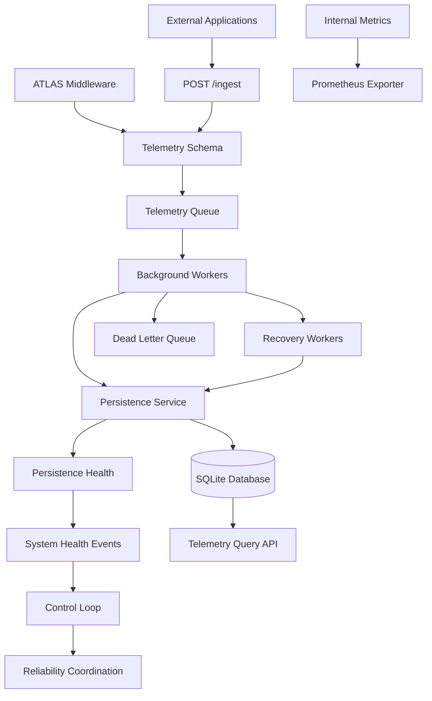

# ATLAS — AI-Native Infrastructure Intelligence Platform

**Building reliable infrastructure monitoring, telemetry processing, and AI-assisted incident intelligence.**

ATLAS is a personal engineering project focused on building an infrastructure intelligence platform that collects telemetry, monitors its own operational health, handles component failures, and lays the foundation for intelligent incident analysis.

The long-term goal is to move beyond collecting metrics: ATLAS aims to understand infrastructure behavior, identify anomalies, correlate operational signals, and recommend evidence-based remediation while keeping humans in control.

> **Project status:** Active development. The telemetry ingestion, processing, persistence, health-monitoring, and querying foundations are implemented. AI-assisted analysis and additional infrastructure integrations are planned.

## Contents

- [Vision](#vision)
- [Architecture](#architecture)
- [Implemented Features](#implemented-features)
- [Technology Stack](#technology-stack)
- [Getting Started](#getting-started)
- [API Endpoints](#api-endpoints)
- [Reliability Design](#reliability-design)
- [Roadmap](#roadmap)
- [Engineering Principles](#engineering-principles)

## Vision

Modern infrastructure generates large amounts of telemetry, but collecting metrics alone does not explain why a system is failing.

ATLAS is being developed around three capabilities:

1. **Observe** — collect application telemetry and measure internal system health.
2. **Understand** — identify unusual behavior, investigate failures, and correlate relevant evidence.
3. **Assist** — use forecasting, anomaly detection, and AI-assisted reasoning to recommend appropriate actions.

The platform is designed to observe its own behavior as well as telemetry from external applications. This dogfooding approach makes ATLAS both an infrastructure platform and a system for exploring reliability engineering.

## Architecture

ATLAS currently uses a modular Python backend built around FastAPI, background workers, and SQLite persistence.



### Telemetry lifecycle

1. Telemetry originates from ATLAS middleware or an external application.
2. Pydantic validates incoming external payloads.
3. Accepted records enter the existing telemetry queue.
4. Background workers process telemetry and attempt persistence.
5. Failed persistence attempts use the existing retry and recovery mechanisms.
6. Records that exhaust their recovery path can be routed to the dead letter queue.
7. Operational health and metrics provide visibility into the processing pipeline.
8. The query API retrieves stored records, including source-specific telemetry.

## Implemented Features

### Telemetry collection and ingestion

- HTTP request instrumentation through FastAPI middleware.
- Structured telemetry schema with request IDs, request metadata, duration, CPU and memory measurements, and source identification.
- External telemetry ingestion through `POST /ingest`.
- Request validation using Pydantic and FastAPI.
- Source-aware telemetry storage and querying.

### Resilient processing

- Background telemetry workers and failed-telemetry recovery workers.
- Queue capacity and priority-aware admission behavior.
- Backpressure and load shedding.
- Persistence-health states: `HEALTHY`, `DEGRADED`, and `UNHEALTHY`.
- Circuit breakers and system-health event propagation.
- Worker heartbeats, supervision, and recovery workflows.
- Dead letter handling for records that cannot be processed through the normal recovery path.

### Operational observability

- Internal metrics aggregation.
- Prometheus-compatible metrics endpoint.
- Health and readiness endpoints.
- Structured logging with request-ID correlation across worker processing and recovery.
- A control loop for coordinating system-health behavior.

### Telemetry querying

- Retrieve recent telemetry through `GET /telemetry`.
- Filter records by source.
- Limit result counts to prevent unbounded queries.
- Parameterized SQL queries and database connection cleanup.

## Technology Stack

| Area | Technologies |
|---|---|
| Backend API | Python, FastAPI |
| Data validation | Pydantic |
| Persistence | SQLite |
| Background processing | Python worker threads and queues |
| Reliability | Retries, circuit breakers, backpressure, load shedding, dead letter handling |
| Observability | Prometheus metrics, structured logging, request correlation |
| Distributed tracing | OpenTelemetry and Jaeger experience |
| AI/ML direction | Anomaly detection, forecasting, LLMs, and Retrieval-Augmented Generation (planned) |

The architecture starts as a modular monolith. Additional infrastructure such as Kafka, distributed storage, and dedicated services will be introduced when a concrete reliability, scaling, or deployment requirement justifies the complexity.

## Getting Started

### Prerequisites

- Python installed
- Git
- PowerShell on Windows, or an equivalent terminal

### 1. Clone the repository

```bash
git clone https://github.com/YOUR_USERNAME/ATLAS.git
cd ATLAS/backend
```

Replace `YOUR_USERNAME` with your GitHub username.

### 2. Create a virtual environment

On Windows PowerShell:

```powershell
python -m venv .venv
.\.venv\Scripts\Activate.ps1
```

### 3. Install dependencies

If the project includes `requirements.txt`:

```powershell
pip install -r requirements.txt
```

### 4. Start the application

```powershell
uvicorn app.main:app --reload
```

The development server should be available at:

- Application root: `http://127.0.0.1:8000/`
- Interactive API documentation: `http://127.0.0.1:8000/docs`

**Note:** These instructions assume the repository includes a complete dependency file and the current database initialization configuration. Verify both before publishing the README as final setup documentation.

## API Endpoints

| Method | Endpoint | Purpose |
|---|---|---|
| `GET` | `/` | Basic application status |
| `GET` | `/health` | Liveness information |
| `GET` | `/ready` | Readiness information |
| `POST` | `/ingest` | Submit external telemetry |
| `GET` | `/telemetry` | Query stored telemetry |
| `GET` | `/internal/metrics` | Retrieve internal metrics |
| `GET` | `/metrics` | Expose Prometheus metrics |
| `GET` | `/docs` | Interactive API documentation |

### Submit external telemetry

Example request:

```http
POST /ingest
Content-Type: application/json
```

```json
{
  "request_id": "external-test-001",
  "method": "GET",
  "path": "/demo-service/orders",
  "status_code": 200,
  "duration_ms": 42.5,
  "cpu_percent": 23.4,
  "memory_percent": 61.2,
  "source": "demo-service"
}
```

A successful queue admission returns `202 Accepted`. Invalid request bodies are rejected by FastAPI validation, while requests that cannot be accepted by the queue receive an error response.

A `202` response indicates acceptance for processing, not a guarantee that the record has already been persisted.

### Query telemetry by source

```http
GET /telemetry?source=demo-service&limit=10
```

The query API returns matching records, newest first, subject to the configured result limit.

**Security note:** The current ingestion API is a development implementation and should not be exposed publicly without appropriate authentication, authorization, and request controls.

## Reliability Design

ATLAS is being built with explicit failure handling rather than assuming every component remains healthy.

### Persistence failures

The persistence-health subsystem tracks operational state and publishes health events when failures or recoveries are detected. Workers use the existing retry, recovery, and dead letter workflows to handle failed records.

The next reliability milestone is to coordinate recovery more deliberately when persistence becomes healthy again, including controlled retries for eligible records that reached the dead letter queue.

### Backpressure and load shedding

Queues cannot grow without limits. ATLAS uses queue capacity, processing pressure, and telemetry priority to guide admission and load-shedding behavior.

The objective is to protect the processing pipeline under load while making dropped or failed telemetry visible through operational metrics.

### Observability

ATLAS exposes internal metrics, health endpoints, Prometheus metrics, and structured logs with request correlation. These features are intended to help identify bottlenecks and investigate failures across the telemetry lifecycle.

## Roadmap

The roadmap is organized around measurable engineering capabilities rather than adding technologies for their own sake.

### Phase 1 — Reliability and telemetry foundations

- [x] Internal telemetry collection and persistence
- [x] External telemetry ingestion
- [x] Source-aware querying
- [x] Persistence health and recovery workers
- [x] Backpressure and load shedding
- [x] Circuit breakers and worker supervision
- [x] Internal metrics and Prometheus exposition
- [ ] Time-range filtering for telemetry queries
- [ ] Recovery coordination for eligible dead-lettered records
- [ ] Expanded failure-injection and integration tests

### Phase 2 — Deployment and infrastructure integration

- [ ] Reproducible Docker-based deployment
- [ ] Configuration and secrets management suitable for deployment
- [ ] External telemetry integration and clearer service-level boundaries
- [ ] Stronger persistence and recovery guarantees
- [ ] Improved operational dashboards and incident investigation workflows

### Phase 3 — Infrastructure intelligence

- [ ] Baseline-based anomaly detection
- [ ] Time-series forecasting for selected infrastructure metrics
- [ ] Correlation of telemetry anomalies with health events
- [ ] Incident summaries grounded in observed evidence
- [ ] RAG-based retrieval over operational knowledge and incident history
- [ ] LLM-assisted explanations and remediation recommendations
- [ ] Human approval and policy safeguards for consequential actions

Roadmap items are planned work and are not represented as completed capabilities.

## Engineering Principles

- **Observe before acting:** decisions should be grounded in telemetry and health evidence.
- **Reliability first:** failure detection and recovery must be understandable and testable.
- **Human control:** AI recommendations should not automatically trigger risky remediation.
- **Incremental architecture:** introduce complexity when a demonstrated need justifies it.
- **Dogfooding:** ATLAS should monitor and expose the behavior of its own components.
- **Evidence over buzzwords:** prioritize measurable behavior, clear trade-offs, and reproducible tests.

## Project Status

ATLAS is an active personal engineering project focused on backend reliability, observability, and AI infrastructure.

The current implementation establishes the telemetry processing and operational-health foundation. The next stages focus on stronger recovery guarantees, reproducible deployment, infrastructure integration, and evaluated AI-assisted intelligence.

---

**Built as a hands-on exploration of backend engineering, infrastructure reliability, observability, and AI-assisted systems.**