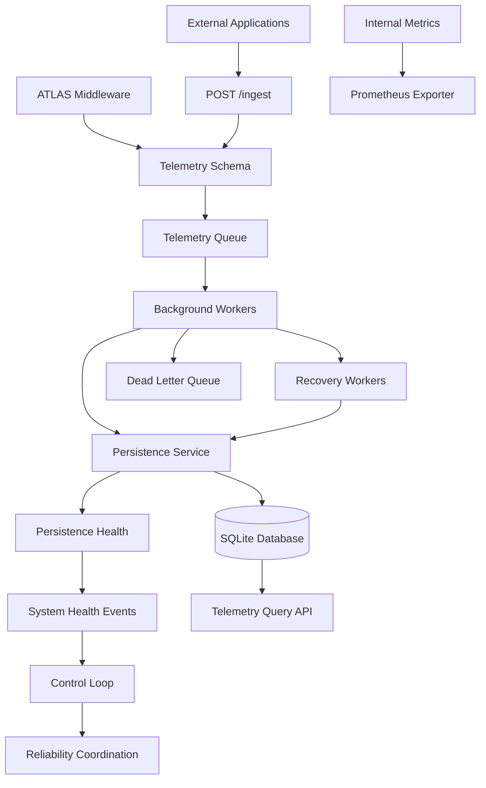

# ATLAS — AI-Native Infrastructure Intelligence Platform

**A reliability-focused infrastructure intelligence platform for telemetry ingestion, resilient processing, operational health, and AI-assisted incident analysis.**

ATLAS is an actively developed engineering project exploring how infrastructure systems can do more than collect metrics. It is designed to ingest telemetry, make processing failures visible, recover from component problems, and establish a foundation for evidence-based incident investigation.

The long-term direction is to connect telemetry, health events, anomaly detection, forecasting, and operational knowledge so that ATLAS can help explain *what is happening, why it may be happening, and what an operator could do next*—with humans retaining control over consequential actions.

> **Status:** The current project focuses on telemetry processing and reliability foundations. AI-assisted analysis, forecasting, RAG, and additional infrastructure integrations are roadmap items, not claims of completed functionality.

## Why ATLAS?

Metrics are useful, but a metric by itself rarely explains an incident. A useful infrastructure platform also needs to make its own failures observable, manage pressure when components fall behind, and provide a traceable path from incoming telemetry to stored and queryable records.

ATLAS explores that engineering problem through three themes:

- **Observe:** Collect application telemetry and expose internal operational metrics.
- **Protect:** Handle queue pressure, persistence failures, worker problems, and recovery paths.
- **Investigate:** Make telemetry and health information queryable as a foundation for future anomaly detection and AI-assisted incident analysis.

A core design principle is **dogfooding**: ATLAS should expose and monitor the behavior of its own components, not only external applications.

## Architecture

ATLAS currently uses a modular Python backend built around FastAPI, background processing, and SQLite persistence.



### Telemetry lifecycle

1. Telemetry originates from ATLAS middleware or an external application.
2. FastAPI and Pydantic validate external payloads.
3. Accepted records enter the telemetry queue.
4. Background workers process records and attempt persistence.
5. Failed persistence attempts use the existing retry and recovery mechanisms.
6. Records that exhaust their recovery path can be routed to the dead letter queue.
7. Internal metrics, health signals, and structured logs provide visibility into the pipeline.
8. The query API retrieves stored records, including source-specific telemetry.

The architecture starts as a **modular monolith**. Additional infrastructure should be introduced when a demonstrated reliability, scaling, or deployment requirement justifies the added complexity.

## Implemented Capabilities

The following reflects the project's documented current implementation. Individual components and failure paths should continue to be validated through tests and failure-injection scenarios.

### Telemetry Ingestion and Querying

- FastAPI middleware for internal request instrumentation.
- Structured telemetry payloads containing request identifiers, request metadata, duration, CPU and memory measurements, and source information.
- External telemetry ingestion through `POST /ingest`.
- Request validation using Pydantic and FastAPI.
- Source-aware telemetry storage and querying.
- `GET /telemetry` query support with source filtering and bounded result counts.

### Resilient Processing

- Background telemetry workers and failed-telemetry recovery workers.
- Queue-capacity and priority-aware admission behavior.
- Backpressure and load shedding.
- Persistence-health states: `HEALTHY`, `DEGRADED`, and `UNHEALTHY`.
- Circuit breakers and system-health event propagation.
- Worker heartbeats, supervision, and recovery workflows.
- Dead-letter handling for records that cannot proceed through the normal recovery path.

### Operational Observability

- Internal metrics aggregation.
- Prometheus-compatible metrics exposition.
- Health and readiness endpoints.
- Structured logging with request-ID correlation across worker processing and recovery.
- A control loop for coordinating system-health behavior.

## Technology Stack

| Area | Technologies |
|---|---|
| API and Backend | Python, FastAPI |
| Data Validation | Pydantic |
| Persistence | SQLite |
| Background Processing | Python worker threads and queues |
| Reliability Patterns | Retries, circuit breakers, backpressure, load shedding, dead-letter handling |
| Operational Observability | Prometheus metrics, structured logging, request correlation |
| Tracing Experience | OpenTelemetry, Jaeger |
| Planned AI/ML Direction | Anomaly detection, time-series forecasting, LLM-assisted analysis, retrieval-augmented generation |

OpenTelemetry and Jaeger are part of the project's tracing experience; they should not be interpreted as proof that every tracing integration is currently deployed in the main ATLAS pipeline. Likewise, the AI/ML items above describe the intended direction rather than completed features.

## API Overview

The documented API surface includes the following endpoints:

| Method | Endpoint | Purpose |
|---|---|---|
| `GET` | `/` | Basic application status |
| `GET` | `/health` | Liveness information |
| `GET` | `/ready` | Readiness information |
| `POST` | `/ingest` | Submit external telemetry |
| `GET` | `/telemetry` | Query stored telemetry |
| `GET` | `/internal/metrics` | Retrieve internal metrics |
| `GET` | `/metrics` | Expose Prometheus metrics |
| `GET` | `/docs` | Interactive API documentation |

### Example: Submit Telemetry

```http
POST /ingest
Content-Type: application/json
```

```json
{
  "request_id": "external-test-001",
  "method": "GET",
  "path": "/demo-service/orders",
  "status_code": 200,
  "duration_ms": 42.5,
  "cpu_percent": 23.4,
  "memory_percent": 61.2,
  "source": "demo-service"
}
```

A successful queue admission is documented to return `202 Accepted`. This means the record has been accepted for processing; it does **not** guarantee that persistence has already completed. Invalid payloads are rejected by request validation, while records the queue cannot accept receive an error response.

### Example: Query Telemetry by Source

```http
GET /telemetry?source=demo-service&limit=10
```

The query API returns matching records newest first, subject to the configured result limit.

> **Security note:** Treat the ingestion API as a development implementation unless authentication, authorization, rate limits, and appropriate deployment controls have been added and verified. Do not expose it publicly on the assumption that the example configuration is production-secure.

## Reliability Design

### Persistence Failures and Recovery

The persistence-health subsystem tracks operational state and publishes health events when failures or recoveries are detected. Workers use retry, recovery, and dead-letter workflows to handle failed records.

A documented next step is to coordinate recovery more deliberately after persistence becomes healthy again, including controlled retries for eligible records that reached the dead-letter queue.

### Backpressure and Load Shedding

Queues cannot grow without limits. ATLAS uses queue capacity, processing pressure, and telemetry priority to guide admission and load-shedding behavior. The goal is to protect the processing pipeline under load while making dropped or failed telemetry visible through operational metrics.

### Internal Observability

Internal metrics, health endpoints, Prometheus exposition, and structured logs with request correlation help make the telemetry pipeline itself observable. This supports debugging bottlenecks and investigating failures across the telemetry lifecycle.

## Roadmap

Roadmap items are planned work, not completed capabilities.

### Phase 1 — Reliability and Telemetry Foundations

- [x] Internal telemetry collection and persistence
- [x] External telemetry ingestion
- [x] Source-aware querying
- [x] Persistence health and recovery workers
- [x] Backpressure and load shedding
- [x] Circuit breakers and worker supervision
- [x] Internal metrics and Prometheus exposition
- [ ] Time-range filtering for telemetry queries
- [ ] Recovery coordination for eligible dead-lettered records
- [ ] Expanded failure-injection and integration tests

### Phase 2 — Deployment and Infrastructure Integration

- [ ] Reproducible Docker-based deployment
- [ ] Deployment-suitable configuration and secrets management
- [ ] External telemetry integration and clearer service boundaries
- [ ] Stronger persistence and recovery guarantees
- [ ] Improved operational dashboards and incident-investigation workflows

### Phase 3 — Infrastructure Intelligence

- [ ] Baseline-based anomaly detection
- [ ] Time-series forecasting for selected infrastructure metrics
- [ ] Correlation of telemetry anomalies with health events
- [ ] Incident summaries grounded in observed evidence
- [ ] RAG over operational knowledge and incident history
- [ ] LLM-assisted explanations and remediation recommendations
- [ ] Human approval and policy safeguards for consequential actions

## Engineering Principles

- **Observe before acting:** Decisions should be grounded in telemetry and health evidence.
- **Reliability first:** Failure detection and recovery should be understandable and testable.
- **Human control:** AI recommendations should not automatically trigger risky remediation.
- **Incremental architecture:** Add complexity when a demonstrated need justifies it.
- **Dogfooding:** ATLAS should monitor and expose the behavior of its own components.
- **Evidence over buzzwords:** Prioritize measurable behavior, explicit trade-offs, and reproducible tests.

## Current Status

ATLAS is an active personal engineering project focused on backend engineering, infrastructure reliability, and observability. The current implementation establishes a foundation for telemetry processing and operational health. The next stages focus on stronger recovery guarantees, reproducible deployment, infrastructure integration, and evaluated AI-assisted intelligence.

---

*Built as a hands-on exploration of backend engineering, infrastructure reliability, observability, and AI-assisted systems.*